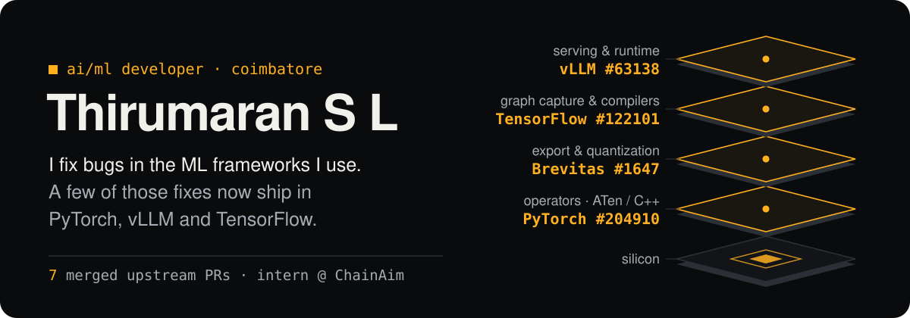

<picture>
  <source media="(prefers-color-scheme: dark)" srcset="./assets/readme/header-dark.svg">
  <source media="(prefers-color-scheme: light)" srcset="./assets/readme/header-light.svg">
  
</picture>

  

  
  
  
  

### Merged upstream

| Pull request | What it fixed |
|---|---|
| [**pytorch/pytorch#204910**](https://github.com/pytorch/pytorch/pull/204910) | `torch.from_file(shared=True)` no longer zeroes byte 0 when it grows a file |
| [**vllm-project/vllm#63138**](https://github.com/vllm-project/vllm/pull/63138) | `--sleep-mode-backend` flag, so plugin sleep-mode backends can be selected |
| [**tensorflow/tensorflow#122101**](https://github.com/tensorflow/tensorflow/pull/122101) | Documented why seeds differ across eager, `tf.function` and XLA |
| [**Xilinx/brevitas#1647**](https://github.com/Xilinx/brevitas/pull/1647) | Float LSTM ONNX export with dynamo, which used to write an empty graph |

+3 more (PyTorch, Aider, Electric Capital Quest) → [mrmaran.me/open-source](https://mrmaran.me/open-source)

### Now

Intern developer at **ChainAim**, building zero-knowledge tooling (ZK Pret, Actus) on Mina.

### Built

| Project | What it does |
|---|---|
| [**NewtonLab**](https://github.com/Mramaran/newtonlab) | Paste a physics problem, get a simulation you can play with |
| [**AgriSentinel**](https://github.com/Mramaran/agrisentinel) | Scan a tomato leaf, see how bad the disease is, in Tamil or English |
| [**Inspection Image Restoration**](https://github.com/Mramaran/Image-enhancer) | One DRUNet pass denoises semiconductor inspection images and doubles their resolution |

### Stack

  

### Activity

  
  

  

  

<picture>
  <source media="(prefers-color-scheme: dark)" srcset="https://raw.githubusercontent.com/Mramaran/Mramaran/output/snake-dark.svg">
  <source media="(prefers-color-scheme: light)" srcset="https://raw.githubusercontent.com/Mramaran/Mramaran/output/snake-light.svg">
  
</picture>
